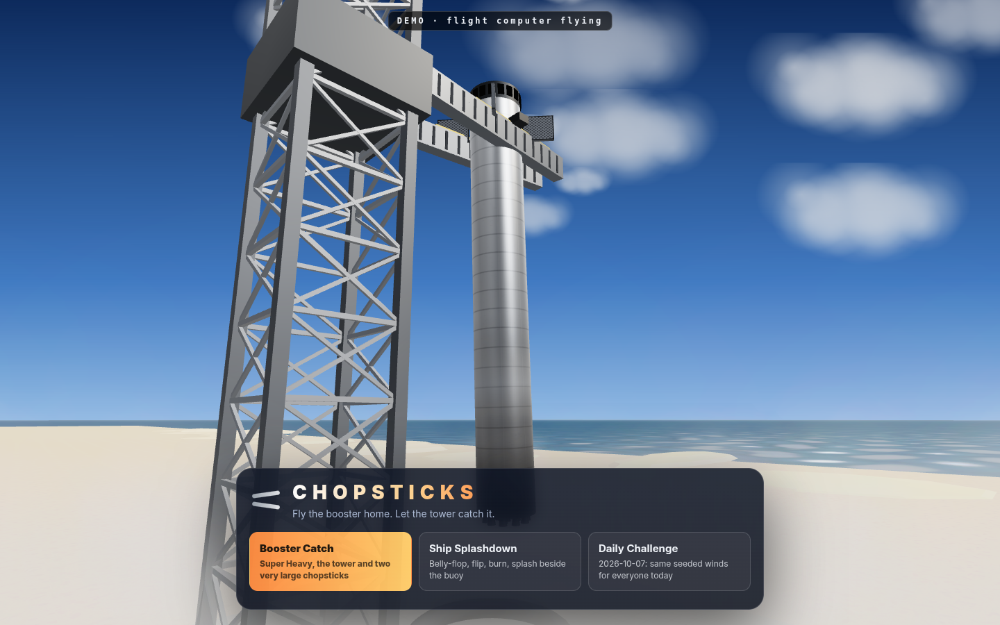
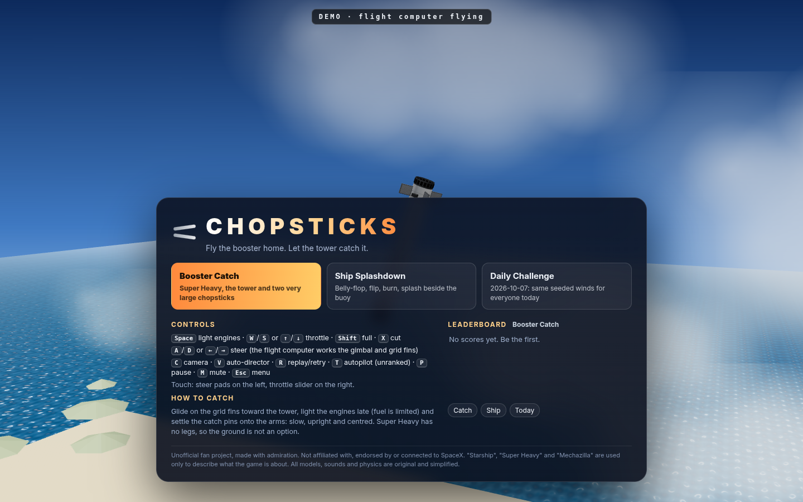
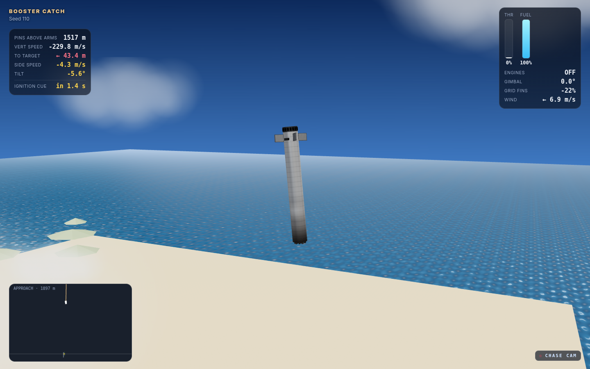
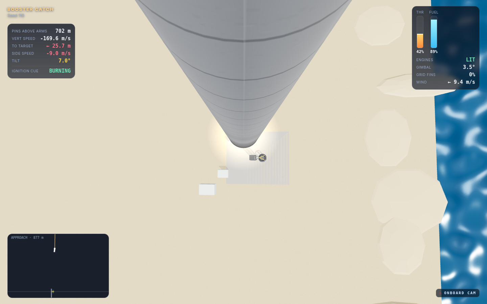
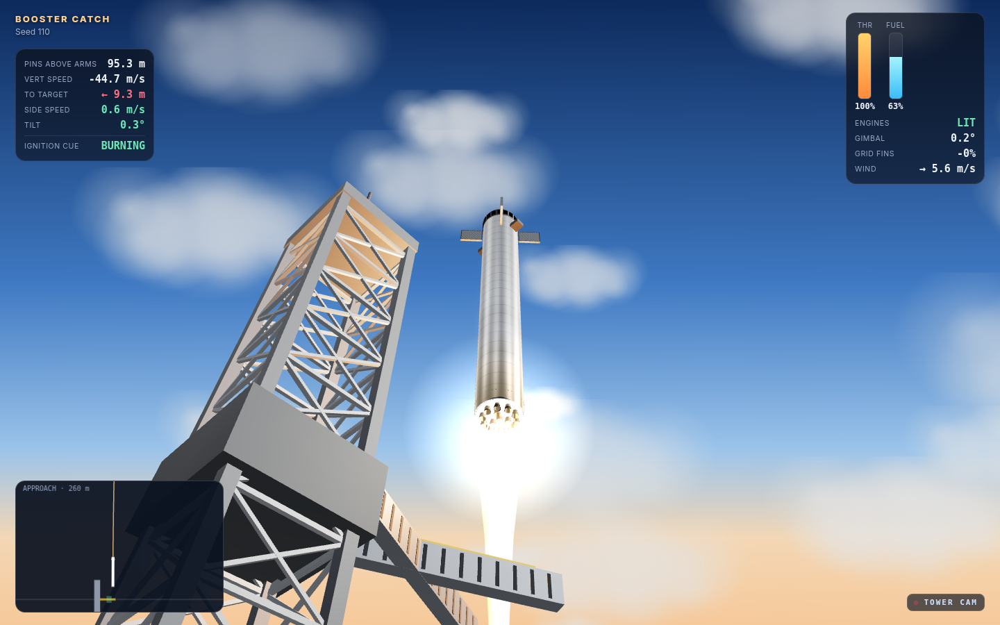
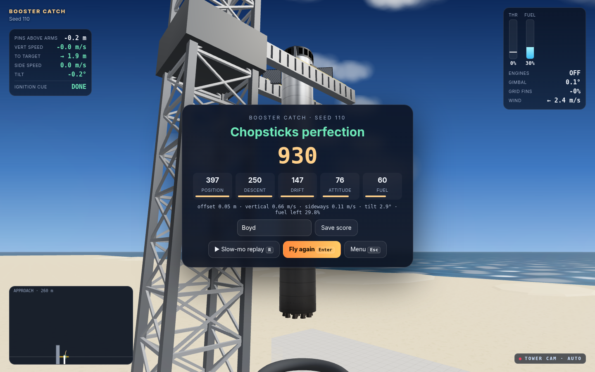
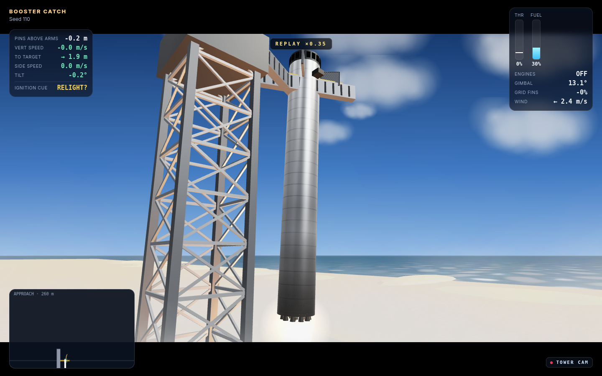
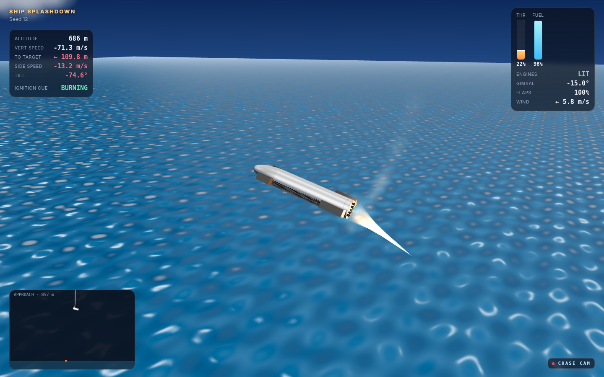
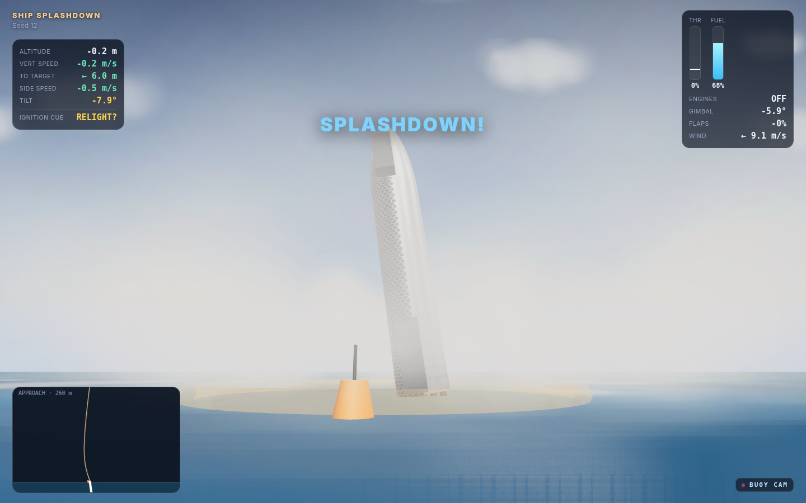
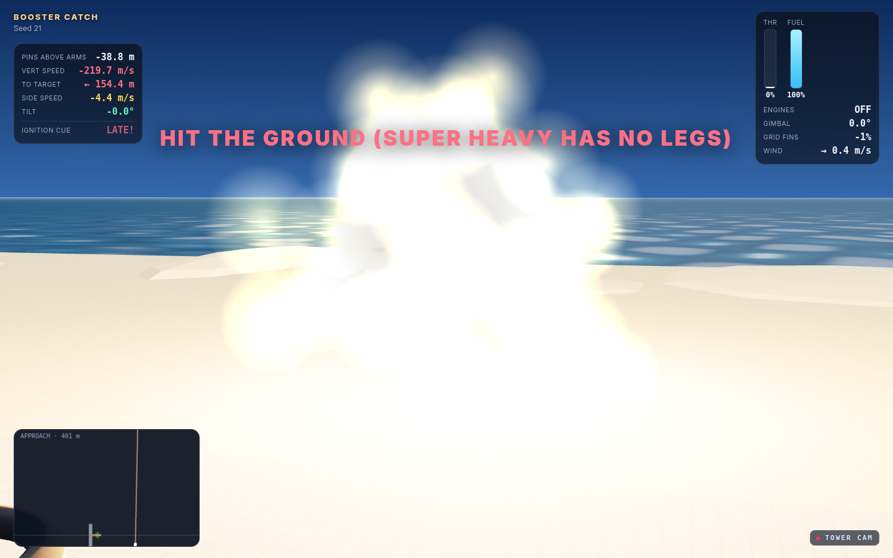

# Chopsticks

**Fly a Super Heavy booster home through gusting winds and set its catch pins down on the tower's chopsticks: slow, upright and centred.**

A 3D browser game built with Three.js, which is vendored and bundled so it works fully offline. It's fan-made and unofficial; see the note at the bottom.

- **Play live:** http://127.0.0.1:4242 (start it with `./run.sh`, stop it with `./stop.sh`)
- **Offline, single file:** `dist/chopsticks-snapshot.html` (~540 KB, with three.js, the game, CSS and the procedural textures all inlined). Open it straight from disk. It makes no network requests.



## Modes
| Mode | What you do |
|---|---|
| **Booster Catch** (main) | You start 3.2–3.8 km up, falling at about 200 m/s, 110–370 m out over the water. Glide on the grid fins toward the tower, light the engines late (propellant is limited), then lower the catch pins onto the arms. The arms close by themselves once you're lined up between them. Super Heavy has no legs, so landing on the ground or the launch mount ends in a fireball. |
| **Ship Splashdown** (bonus) | You start in a Starship belly-flop at about 65 m/s. Steer with the flaps, light the engines to flip upright, then burn down and splash gently beside the buoy. Even a good splashdown tips over afterwards, just like the real test flights. |
| **Daily Challenge** | A Booster Catch with stronger gusts and a start position seeded from today's date (ET). Everyone gets the same winds that day, and it has its own leaderboard. |

The **attract mode** plays itself behind the menu: the flight computer flies a full catch, the menu shrinks out of the way for the final approach, and then a slow-motion replay runs before the next demo flight.

## Controls
| | Keyboard | Touch |
|---|---|---|
| Light engines | `Space` (starts at 65%) | IGNITE |
| Throttle | `W`/`S` or `↑`/`↓`, `Shift` for full, `X` to cut | vertical slider |
| Steer | `A`/`D` or `←`/`→` | ◀ ▶ pads |
| Camera | `C` to cycle, `V` for the auto-director | CAM |
| Other | `R` replay or retry, `T` autopilot (unranked), `P` pause, `M` mute, `Esc` menu | |

Steering asks the flight computer to lean you in that direction. It works out the gimbal and grid fins for you. While unpowered, the grid fins glide you sideways; once lit, the engine gimbal does the work. The HUD shows both, along with an **ignition cue** that uses the same suicide-burn estimate as the autopilot.

## Physics (simplified and game-tuned)
`src/sim.js` is pure JS with no DOM, so it runs in the browser and in Node. It's a 2-D rigid body (downrange, altitude and tilt), stepped at 120 Hz, drawn in 3D.
- **Gravity** is 9.81 m/s². **Drag** is split into axial and crossflow parts, with air density falling off with altitude. Free-falling tail-first, the booster tops out around 230 m/s.
- **Thrust:** 12 MN at most, with a 12% minimum throttle, a 0.6 s spool-up and a rate-limited throttle. Propellant burns at 330 s Isp from a 40 t landing reserve on a 180 t dry booster. Run out and you flame out.
- **Gimbal:** ±15°, rate-limited. It provides torque about the centre of mass.
- **Grid fins and flaps:** their authority scales with dynamic pressure, so they're strong when fast and useless when slow. There's also passive weathervane stability and aero damping.
- **Wind:** a steady base, a slow swell, and seeded **gusts** of 4–13 m/s (stronger in the Daily). Wind is weaker near the ground.
- **Catch rule:** when the pins cross the arm height, the catch counts if |offset| ≤ 6 m, vertical speed ≤ 12 m/s, sideways speed ≤ 6 m/s and tilt ≤ 15°. You can also fail by hitting the tower, clipping an arm, landing on the mount or hitting the ground.

These numbers are loose approximations chosen for fun. They aren't real flight data.

## Scoring (catch precision, out of 1000)
| | Booster Catch | Ship Splashdown |
|---|---|---|
| Position | 400 (0 m = full, 6 m = 0) | 300 (0 m = full, 60 m = 0) |
| Descent rate | 250 (≤ 1 m/s = full, 10 m/s = 0) | 300 (≤ 1.5 m/s = full) |
| Sideways drift | 150 (0 m/s = full, 5 m/s = 0) | 100 |
| Attitude | 100 (upright = full, 12° = 0) | 200 (upright = full, 15° = 0) |
| Fuel left | 100 (half the reserve or more = full) | 100 |

Score titles: 920+ "Chopsticks perfection", 800+ "Textbook catch", 650+ "Solid catch", 450+ "Caught it". Scores save to a `localStorage` leaderboard with one board for Catch, one for Ship, and one per Daily date. Flights where you used the autopilot are never ranked.

## Cameras, replay, sound
- **Chase cam**, **onboard cam** (looking down the booster at the tower) and **tower cam** (from low on the tower, looking up past the chopsticks). Ship mode swaps the tower cam for a **buoy cam**. The auto-director cuts between them by flight phase.
- **Slow-mo replay** at ×0.35 with letterbox bars. It plays the last 8 s before the catch or crash, cuts between cameras every 2 s, and lands on the tower cam for the moment of contact.
- **All sound is synthesized with WebAudio**, with no audio files:
  - an engine roar plus a sub-bass rumble and crackle that follow the throttle;
  - wind that follows speed and dynamic pressure;
  - the double sonic boom on return;
  - the hydraulic whine as the arms close and a metallic clank on contact;
  - gust whooshes, an explosion and a splash;
  - a little victory arpeggio.

## Tests
`tests/run.sh` starts the server if needed, then runs `node tests/smoke.mjs`.
- **Headless physics in Node:** across 100 seeds the autopilot catches at least 90% of boosters (latest run: 96/100, average score 851). The attract-mode seed is a catch. The Daily catches at least 25/30 seeds and Ship splashes at least 38/40. It also checks:
  - determinism;
  - the drag-limited fall speed;
  - fuel accounting;
  - no engines means a "no legs" crash;
  - scores stay within 0–1000.
- **Server and offline build:** `/api/health` on :4242, the fan note is present, and the snapshot is a single file that references nothing on the network.
- **Real headless Chrome on the offline file:**
  - the attract demo flies to a catch;
  - Enter starts a game, Space lights the engines and A steers;
  - the HUD is live;
  - there are no page errors and no network requests.

## Files
```
src/sim.js        flight model, wind, catch/score rules, autopilot, ignition cue (DOM-free)
src/scene.js      three.js world: tower + chopsticks, launch mount, booster/ship models, plume
src/textures.js   procedural canvas textures (steel, tiles, grid fins, plume, clouds, water)
src/audio.js      WebAudio synth
src/main.js       game shell: modes, input, cameras/director, replay, HUD + approach scope, leaderboard
web/              index.html, style.css, game.js (bundled)       server.py  static server, :4242
build.mjs         esbuild bundle -> web/game.js, then inline -> dist/chopsticks-snapshot.html
tools/            shots.mjs (1440x900 screenshots), gif.mjs (gameplay GIF), aptest.mjs / trace.mjs (autopilot tuning)
tests/            smoke.mjs, run.sh
```
To rebuild after editing `src/`, run `node build.mjs`. `npm install` restores `node_modules` (three, esbuild, puppeteer-core).

## Screenshots (1440×900)
| | |
|---|---|
|  attract-mode catch |  menu over the demo |
|  grid-fin glide |  onboard cam, landing burn |
|  tower cam, final approach |  score card |
|  slow-mo replay |  ship flip manoeuvre |
|  buoy cam splashdown |  no legs! |

Gameplay GIF: `screenshots/gameplay.gif` (autopilot flying from the landing burn to a catch, about 2× speed).

## Fan-project note
This is an unofficial fan project made by TokenMax for Boyd, a big Starship fan. It is not affiliated with, endorsed by or connected to SpaceX. "Starship", "Super Heavy" and "Mechazilla" appear only as descriptive names. There are no logos or trademarks beyond those names. All models, textures, sounds and physics are original and simplified. three.js is MIT-licensed, and its licence comment is kept in the bundle.


---
## Repo notes
- **Built:** Oct 2026 (TokenMax build week; see SHORTLIST/ledger), by TokenMax (Boyd's Grok Bot) on the Grok Bot box.
- **Run:** `./run.sh` (then open the localhost URL it prints).
- Imported from `/workspace/tokenmax/chopsticks` on Oct 23, 2026. node_modules, virtualenvs, logs and files over 20 MB were left out.
